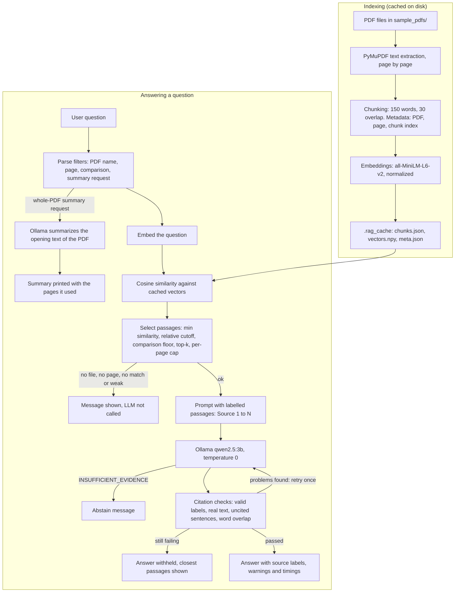
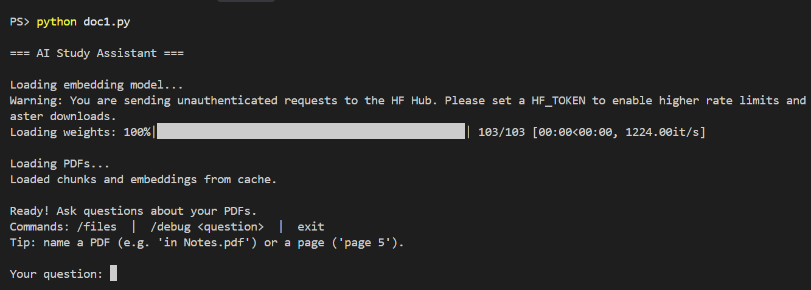
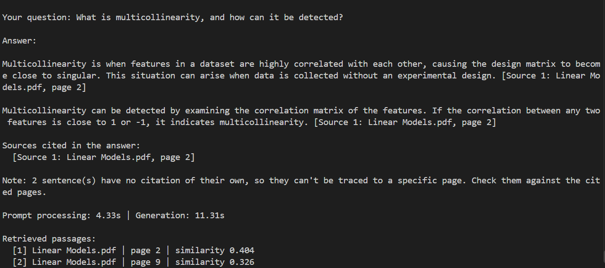
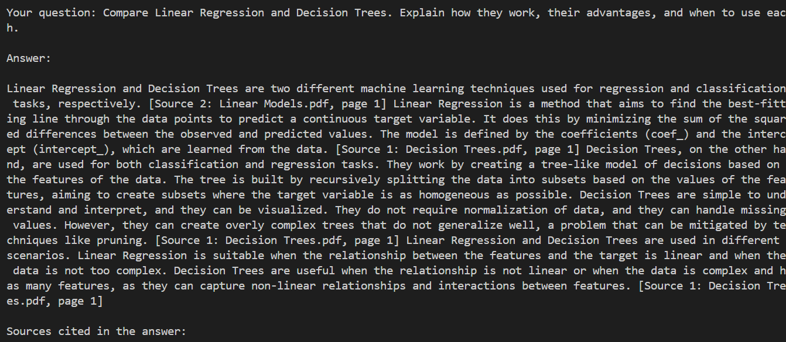
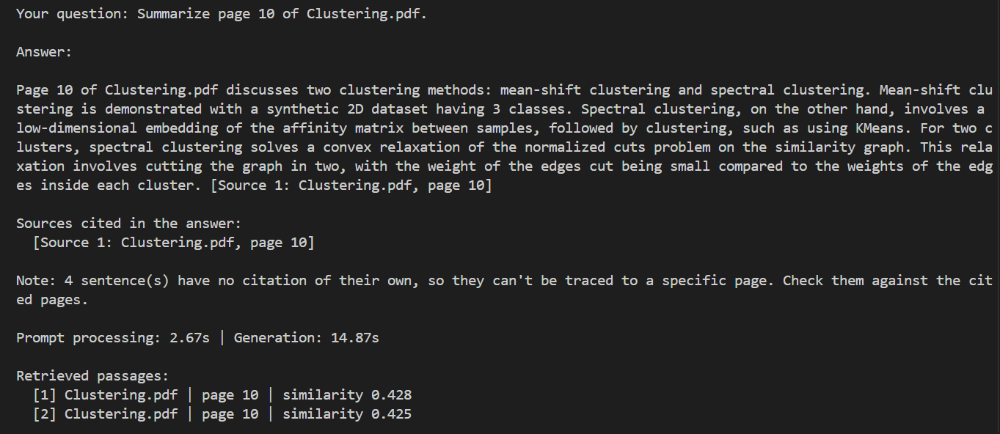
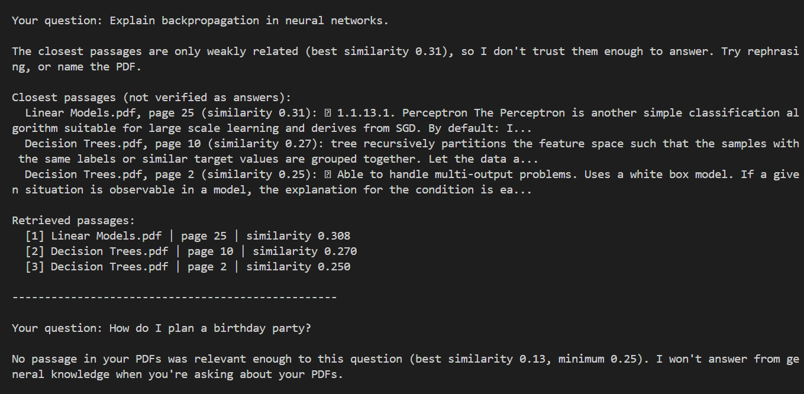
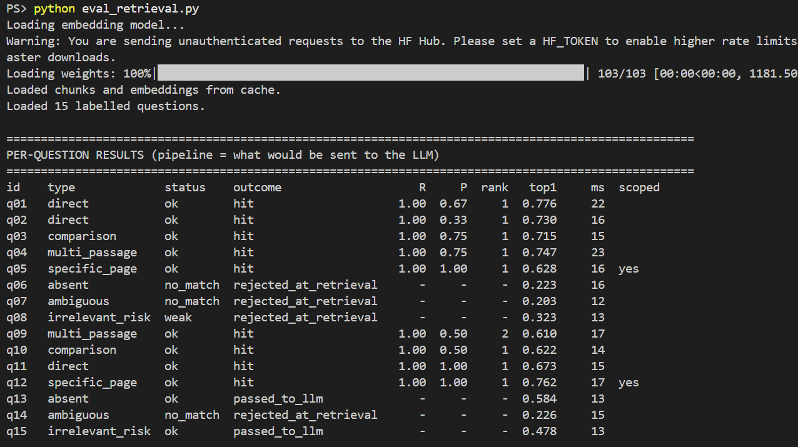
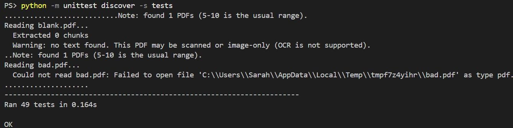

# AI Study Assistant

A local, citation-aware question-answering assistant for your own PDFs. It retrieves the most relevant pages, asks a local LLM to answer **only** from them, checks the citations in Python, and declines to answer when the evidence is missing.

Everything runs on your machine: PyMuPDF for text extraction, `all-MiniLM-L6-v2` embeddings, cosine-similarity retrieval with NumPy, and `qwen2.5:3b` through [Ollama](https://ollama.com). It is a terminal application. It is not deployed anywhere.

## Features

- **Page-aware indexing.** PDF text is extracted page by page and split into 150-word chunks with a 30-word overlap. Each chunk keeps its PDF name, page number and chunk index.
- **Local embedding cache.** Chunks and vectors are saved in `.rag_cache/` and rebuilt automatically when a PDF, the chunk settings or the embedding model changes.
- **Filtered retrieval.** Cosine similarity with a minimum-similarity threshold, a relative cutoff, a weak-match check, top-k selection and a per-page cap.
- **Question analysis.** Questions can name a PDF (`in Clustering.pdf`), a page (`page 10`) or ask for a comparison. Comparison questions pull passages from more than one PDF, and a passage from a PDF with no real match is dropped.
- **Source references on every answer.** Passages are labelled `[Source N]` in the prompt. The label is replaced with `[Source N: file.pdf, page X]` in the answer, and the cited pages are listed.
- **Citation checks.** Labels are validated in Python. Invalid, missing or label-only answers are not shown as answers. Uncited sentences, weak word overlap and truncated answers produce warnings.
- **Abstention.** The assistant declines when no passage is relevant enough, when the best match is weak, or when the model replies that the passages do not contain the answer.
- **Clear errors.** Ollama not running, a timeout, a missing model and an unreadable reply each get their own message. Scanned or unreadable PDFs are reported.
- **Commands.** `/files` lists the indexed PDFs. `/debug <question>` prints raw similarity scores. A request like `Describe each PDF` summarizes the opening text of each PDF.

## Architecture



## Screenshots

**Startup: models loaded and the index read from the cache**



**A cited answer with its source label and timing**



**A comparison question answered from two PDFs**



**A page-specific question**



**Declining when the PDFs do not contain the answer**



**Retrieval evaluation summary**



**Unit tests**




## Setup (Windows PowerShell)

Tested on Windows with Python 3.13.1.

**1. Get the code and create a virtual environment**

```powershell
git clone https://github.com/Sarahdirsipe/ai-study-assistant.git
cd ai-study-assistant
python -m venv .venv
..venvScriptsActivate.ps1
pip install -r requirements.txt
```

If PowerShell blocks the activation script, run `Set-ExecutionPolicy -Scope Process -ExecutionPolicy Bypass` and activate again. `sentence-transformers` installs PyTorch, so the first install is a large download.

**2. Install Ollama and get the model**

Install Ollama from [ollama.com](https://ollama.com), then:

```powershell
ollama pull qwen2.5:3b
ollama list
```

`ollama list` should show `qwen2.5:3b`. On Windows, Ollama normally runs in the background after installation. If the assistant reports that it cannot connect, start it with `ollama serve` in a separate terminal.

**3. Add PDFs**

Put text-based PDFs in `sample_pdfs/`. Scanned, image-only PDFs have no extractable text, and OCR is not supported.

The evaluation in this repository used five pages of the scikit-learn user guide, printed to PDF and saved with these file names. The PDFs are not included in the repository.

| File name | Source page |
|---|---|
| `Choosing the right estimator.pdf` | https://scikit-learn.org/stable/machine_learning_map.html |
| `Clustering.pdf` | https://scikit-learn.org/stable/modules/clustering.html |
| `Decision Trees.pdf` | https://scikit-learn.org/stable/modules/tree.html |
| `Linear Models.pdf` | https://scikit-learn.org/stable/modules/linear_model.html |
| `Support Vector Machines.pdf` | https://scikit-learn.org/stable/modules/svm.html |

The page numbers in the evaluation labels depend on how each page was printed (the original PDFs were printed from scikit-learn 1.9.1 documentation). With a different print layout the page labels will not line up, so the evaluation numbers below apply to those exact files.

**4. Run**

```powershell
python doc1.py
```

The first run downloads the embedding model and builds the cache. Later runs load the cache. Settings (model names, chunk size, thresholds, `OLLAMA_TIMEOUT`) are constants at the top of `doc1.py`.

## Usage

Commands: `/files`, `/debug <question>`, `exit`. Name a PDF (`in Clustering.pdf`) or a page (`page 5`) to narrow the search.

| Question | What happens |
|---|---|
| What problem can multicollinearity cause in Ordinary Least Squares regression? | A short answer with a source label |
| Summarize page 10 of Clustering.pdf, focusing on how Spectral Clustering works and its limitations. | An answer drawn only from page 10 |
| Compare Linear Regression and Decision Trees in how they make predictions. | A comparison with citations from both PDFs |
| Describe each PDF in one line | A short summary of each PDF based on its opening text |
| How does a deep neural network use backpropagation to train its layers? | Declined: no passage is relevant enough |
| How do I make a decision tree for planning a birthday party? | Declined: the model reports insufficient evidence |

Real output from the evaluation run:

```text
Multicollinearity can cause the least-squares estimate to become highly sensitive
to random errors in the observed target, producing a large variance
[Source 1: Linear Models.pdf, page 2].
```

```text
No passage in your PDFs was relevant enough to this question (best similarity 0.22,
minimum 0.25). I won't answer from general knowledge when you're asking about your PDFs.
```

## Evaluation

Retrieval and answer quality are evaluated separately, on 15 questions I wrote and labelled by hand from the PDF pages (`eval/questions.json`). The set covers direct, multi-passage, comparison, page-specific, absent, ambiguous and irrelevant-but-similar-sounding questions. 9 are answerable and 6 are not. Labels are at page level.

This is a small evaluation, written and reviewed by one person. Treat the numbers as indicative, not as a benchmark.

### Retrieval (`eval_retrieval.py`)

| Measure | Result |
|---|---|
| Answerable questions where a relevant page was sent to the LLM | 9 / 9 |
| Mean recall / precision at page level | 1.000 / 0.722 |
| Top-1 passage from the correct PDF / the correct page | 9 / 9 and 8 / 9 |
| Raw cosine ranking (7 unfiltered questions): Recall@1 / @3 / @5 | 0.643 / 0.857 / 0.857 |
| Raw cosine ranking: MRR | 0.929 |
| Unanswerable questions rejected before the LLM | 4 / 6 |
| Retrieval time (embed + search) | about 15 ms mean, 20 ms max |

- The two page-specific questions are excluded from the ranking metrics, because naming the PDF and page already decides the scope.
- The 2 unanswerable questions that were not rejected (Random Forest, a birthday-party decision tree) share vocabulary with the PDFs. Their similarity scores (0.584 and 0.478) overlap the range of answerable questions, so a threshold cannot separate them. The LLM's abstention handled both.
- The thresholds were left at their starting values (`MIN_SIMILARITY` 0.25, `WEAK_SIMILARITY` 0.35, `RELATIVE_CUTOFF` 0.75, `TOP_K` 3, `COMPARE_TOP_K` 4), because the data did not justify changing them.

Changes made because of this evaluation, each tested before and after (`eval/history/` keeps the intermediate results):

- Comparison questions no longer force a passage from a PDF whose best match scores below `WEAK_SIMILARITY`. Passages scoring about 0.25 had been sent alongside relevant ones.
- "Summarize page N of X.pdf" now uses page-filtered retrieval. Before, it returned a generic summary of the PDF's opening pages and ignored the page.
- Adjacent chunks from the same page are no longer skipped. For one comparison question the chunk containing the K-means steps was being dropped, and the model filled the gap with outside knowledge.

### Answers (`eval_answers.py`, reviewed by hand)

I read each answer against the retrieved passages saved in `eval/results_answers.json`. The ratings are in `eval/answer_review.json`.

| Measure | Result |
|---|---|
| Questions answered / declined | 9 / 6 |
| Declined correctly | 6 / 6 (4 at retrieval, 2 by the model) |
| Relevance rated high | 9 / 9 |
| Completeness rated high | 9 / 9 |
| Faithfulness rated high / partial | 8 / 1 |
| Citation correctness rated high / partial | 3 / 6 |

Automatic checks cannot establish faithfulness. A citation proves that a label exists and a page was retrieved, not that the sentence is true. The word-overlap warning is a rough heuristic.

### Latency (one run, one machine)

Measured on an Intel Core i5-1135G7 with 15.8 GB RAM. I did not check which processor Ollama used.

| Step | Time |
|---|---|
| LLM cold start (model load) | 8.9 s |
| Answered questions (n = 9, all attempts) | about 42 s mean, 7.1 to 75.2 s |
| Questions the model declined (n = 2) | about 5.5 to 5.8 s |

7 of the 9 answered questions needed a second attempt, which roughly doubles their time. These are single-run figures and will vary.

### Reproduce

```powershell
python eval_retrieval.py                     # retrieval metrics, no Ollama needed
python eval_answers.py                       # runs the full pipeline, needs Ollama, takes several minutes
python -m unittest discover -s tests -v      # 49 unit tests, no Ollama or PDFs needed
```

Results are written to `eval/results_retrieval.json` and `eval/results_answers.json`. `eval_answers.py` also creates `eval/answer_review.json`, a template for your own ratings, and never overwrites ratings you have already entered.

## Limitations and known failure cases

- **Citations are not proof of correctness.** In the review, the answer to the K-means versus decision trees question contained phrases that appear nowhere in the PDFs, such as the "nearest mean" wording. The citation checks passed anyway.
- **Citation granularity is weak.** The 3B model often puts one label at the end of a multi-sentence answer. In the final run, 30 sentences across 6 answers had no label of their own. The list of cited sources can then attribute a claim to the wrong page: in one answer, the K-means claims were cited to the Affinity Propagation page.
- **The word-overlap warning produces false positives.** On the Spectral Clustering page summary, a sentence was flagged because only the first of two chunks from the same page was compared.
- **The retry costs time.** It helped some answers and did little for others.
- **Retrieval is checked on a small set.** The embedding model is small, labels are at page level, and 15 questions cannot give statistically strong numbers.
- **Chunks start and end mid-sentence,** and the PDFs' page headers and footers (date, URL) are part of the indexed text.
- **No OCR.** Scanned PDFs are reported but cannot be read.
- **No conversation memory.** Each question is answered independently.
- **Local only.** `OLLAMA_URL` points to `localhost`. A hosted version would need a hosted LLM endpoint. The project is not deployed.

## Repository layout

```text
doc1.py                    pipeline and terminal application
eval_retrieval.py          retrieval evaluation
eval_answers.py            answer evaluation and latency
eval/questions.json        15 labelled questions
eval/answer_review.json    manual answer ratings
eval/results_*.json        latest evaluation results
eval/history/              intermediate results from before/after each change
tests/test_core.py         unit tests
requirements.txt           direct dependencies
sample_pdfs/               put your PDFs here (not included)
```

## Acknowledgements

The evaluation used pages from the scikit-learn user guide. scikit-learn is distributed under the BSD 3-Clause license (https://github.com/scikit-learn/scikit-learn). The documentation pages are not included in this repository.